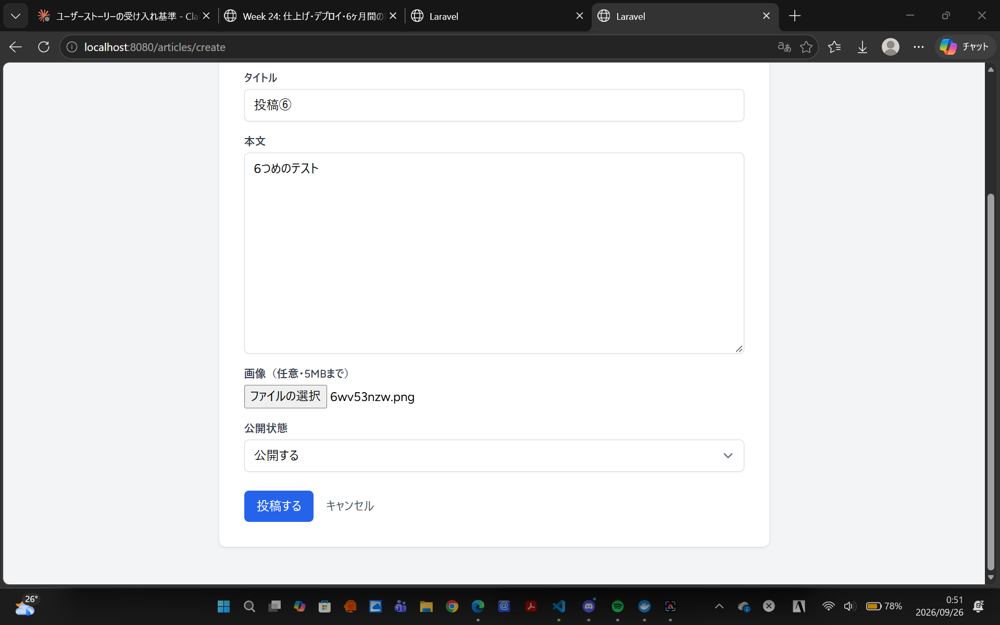
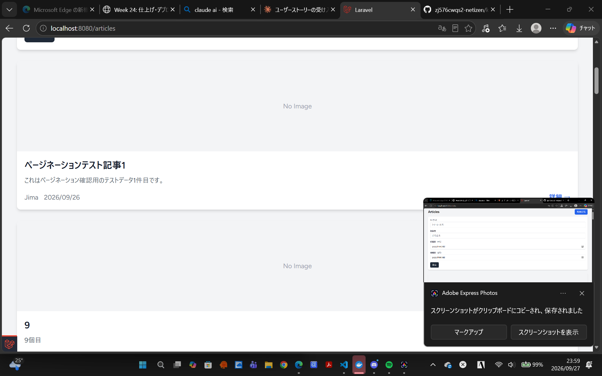
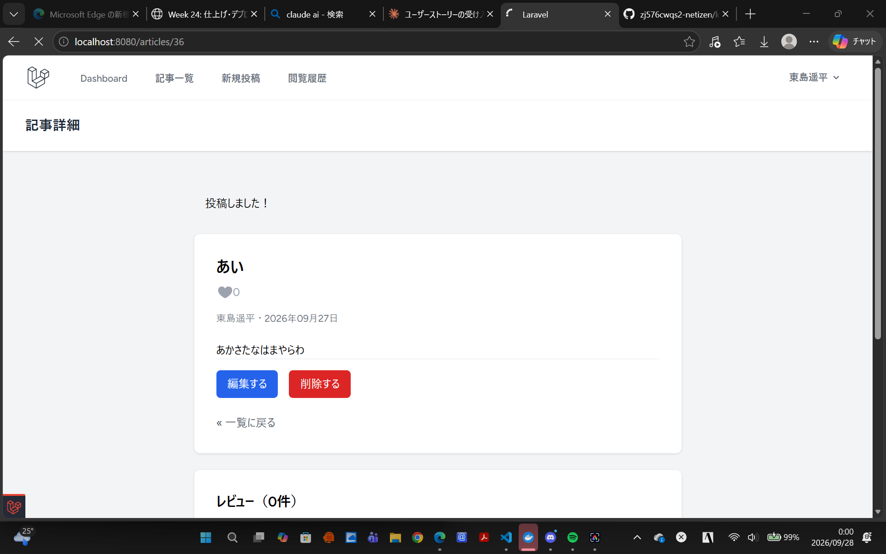
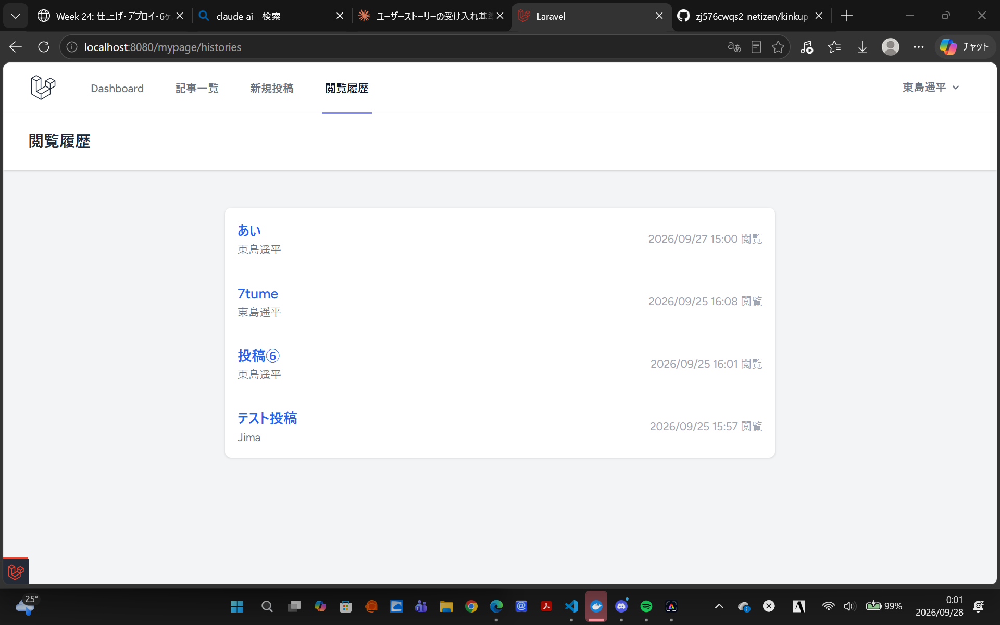
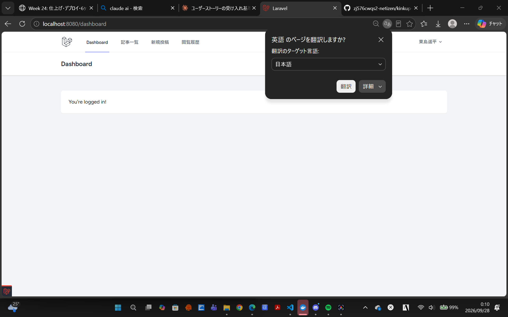

# 記事投稿サイト（Kink up）

【概要】
記事の投稿や閲覧、編集ができるWebアプリケーション。
会員登録したユーザーは、記事の投稿や他のユーザーが投稿した記事の閲覧・検索、レビューを投稿することができます。

URL: https://kinkup-project.onrender.com/

※ Renderの無料プランを使用しているため、しばらくアクセスが無いとスリープし、次回アクセス時に起動まで50秒程度かかることがあります。また、無料プランはディスクが一時的なため、画像は再デプロイのタイミングで消える場合あり。

【実装機能】
- ユーザー登録・ログイン・ログアウト
- 記事投稿（タイトル、本文、画像）
- 記事一覧表示・詳細表示
- 自身で投稿した記事のみ、編集や削除が可能
- 各種検索機能（キーワード、投稿日、投稿者）
- マイページ（プロフィール編集）
- マイページから記事の閲覧履歴を確認可能
- お気に入り機能（Ajax）
- レビュー機能（星評価＋コメント）

## 技術スタック

### バックエンド
- PHP 8.4.25
- Laravel 13.32.0
- MySQL 8.0.46（開発環境）／PostgreSQL（本番環境）

### フロントエンド
- Tailwind CSS 3.1.0
- Alpine.js 3.4.2
- Vite 8.0.0
- Laravel Vite Plugin 3.1
- PostCSS 8.4.31
- Autoprefixer 10.4.2

### インフラ
- Docker（開発環境）
- Render（本番環境）

### 開発ツール
- Git / GitHub
- Claude Code
- Laravel Debugbar

## セットアップ方法

### ①リポジトリのクローン
```bash
git clone https://github.com/zj576cwqs2-netizen/kinkup-project
cd kinkup-project
```

### ②環境設定ファイルの準備
```bash
cp .env.example .env
```

### ③Dockerコンテナの起動
```bash
docker compose up -d
```

### ④依存関係のインストール
```bash
docker compose exec app composer install
docker compose exec app npm install
```

### ⑤アプリケーションキーの生成
```bash
docker compose exec app php artisan key:generate
```

### ⑥マイグレーション実行
```bash
docker compose exec app php artisan migrate
```

### ⑦ストレージリンクの作成
```bash
docker compose exec app php artisan storage:link
```

### ⑧フロントエンド資材のビルド（開発時）
```bash
docker compose exec app npm run dev
```

アプリは http://localhost:8080 でアクセスが可能となっています。

## 📸 スクリーンショット

### トップページ


### 記事一覧


### 記事詳細


### 記事投稿


### 閲覧履歴


## 工夫点

### ①セキュリティ対策とパフォーマンスの最適化
- CSRF保護、XSS対策、SQLインジェクション対策を実装
- ファイルアップロード時にバリデーションを実装
- N+1問題を解決（Eager Loading）

### ②UI/UX
- Tailwind CSSによって、モダンなデザインでのアプリ実装
- Alpine.jsによって快適かつ素早い操作環境を構築
- レスポンシブ対応により、様々なデバイスに対応したページ表示を実装

### ③コード設計
- Policyによって、記事の編集・削除権限を厳重に管理
- FormRequestによるバリデーション分離の実装

## 学習の記録
この総合プロジェクトは、これまでTechmeetsで学んできたAI駆動開発カリキュラムの集大成として作成したWebアプリです。分からないところもたくさんありましたが、頑張って作成しました。

### 今回修得した開発スキル
- Laravel（MVC、認証、Eloquent ORM）
- Docker（開発コンテナ環境の構築）
- Git / GitHub（バージョン管理）
- クラウドサービス（Render）へのデプロイ
- テストの実施（手動テスト）
- 設計（要件定義書作成、DB設計、API設計）

## 作成者
- GitHub: [zj576cwqs2-netizen](https://github.com/zj576cwqs2-netizen)

## ライセンス
MIT License